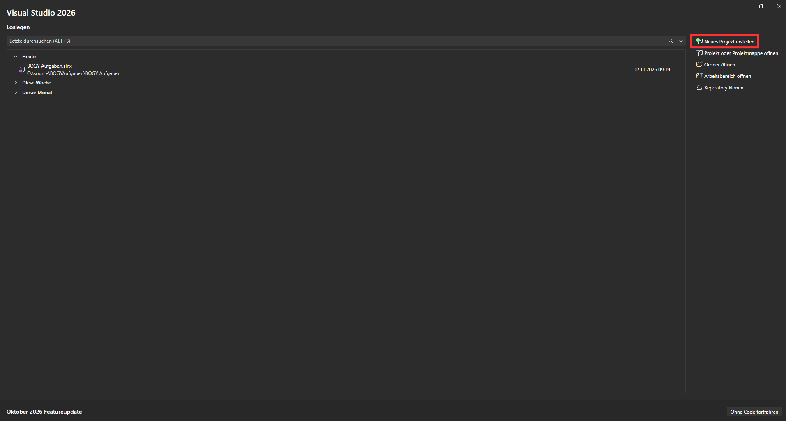
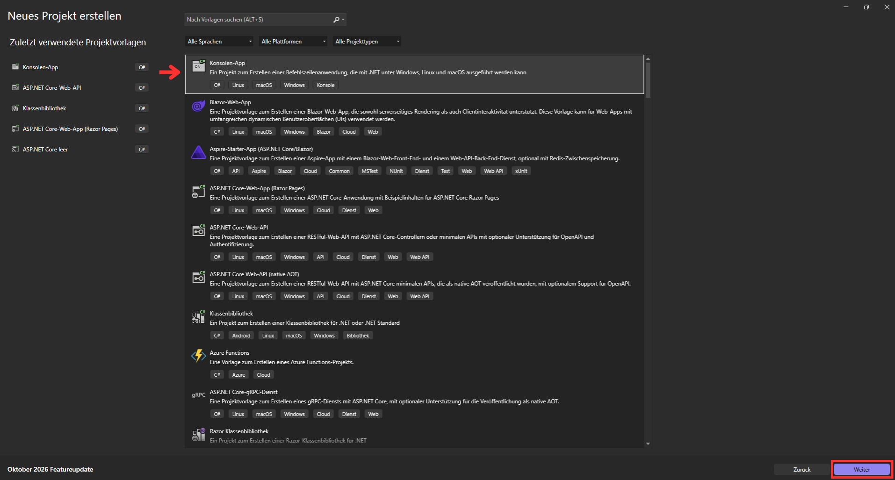
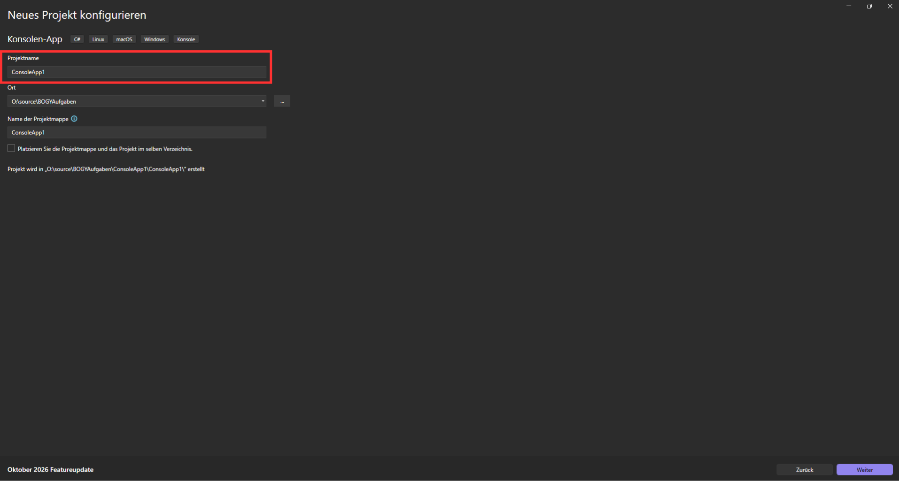
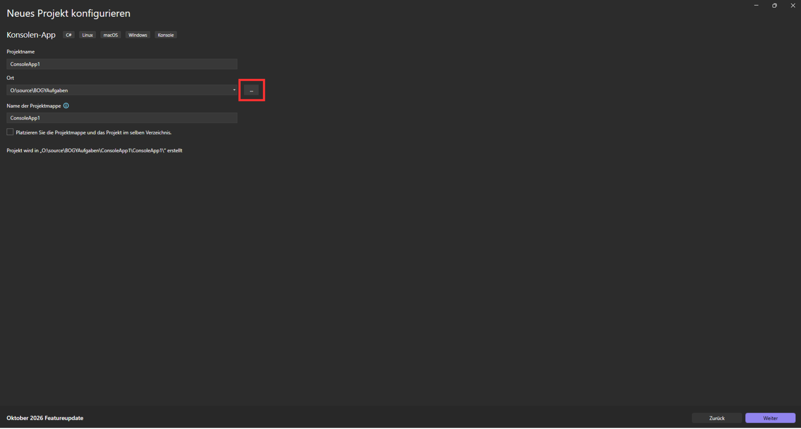
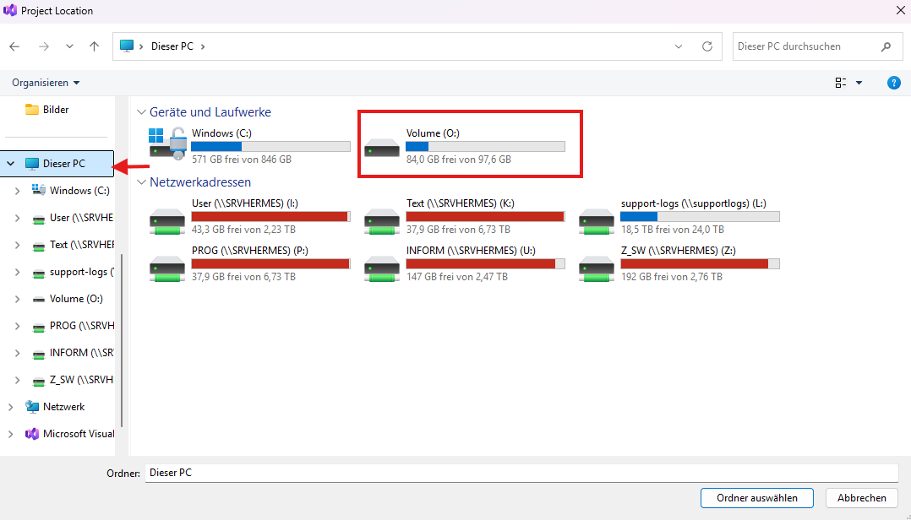
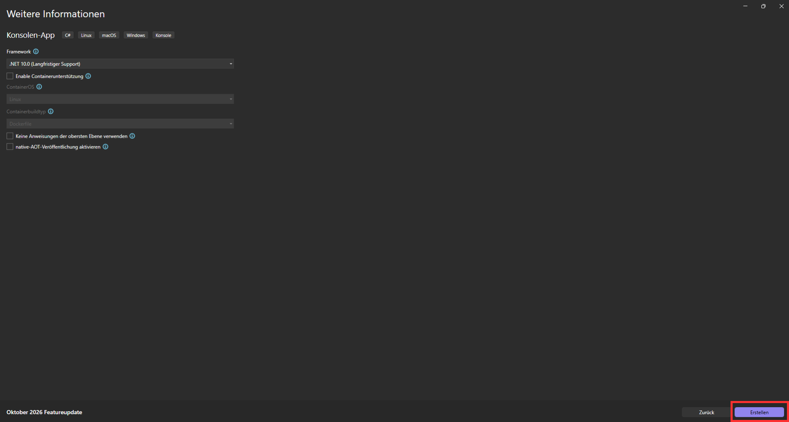

# Neues Projekt erstellen
## Schritt 1
Öffne Visual Studio und drücke auf 'Neues Projekt erstellen'.

## Schritt 2
Wähle 'Konsolen-App' und drücke 'Weiter' oder mache einen Doppelklick auf 'Konsolen-App'.

## Schritt 3
Gebe einen Projektnamen ein. Am besten benennst du die Projekte einfach nach der jeweiligen Aufgabe.

## Schritt 4
Wenn du den Namen eingegeben hast, drücke auf 'Weiter'.

## Schritt 5
Drücke auf die drei Punkte.

## Schritt 6
Wähle in Dieser PC -> O: Den Ordner mit deinem Namen aus.\
Falls dieser nicht existiert, erstelle einen. \
Diesen Schritt musst du nur beim ersten Projekt machen, danach wählt Visual Studio automatisch diesen Ordner aus.

## Schritt 7
Wenn du deinen Ordner ausgewählt hast, drücke rechts unten auf 'Weiter'.

## Schritt 8
Klicke auf 'Erstellen'

## Fertig
